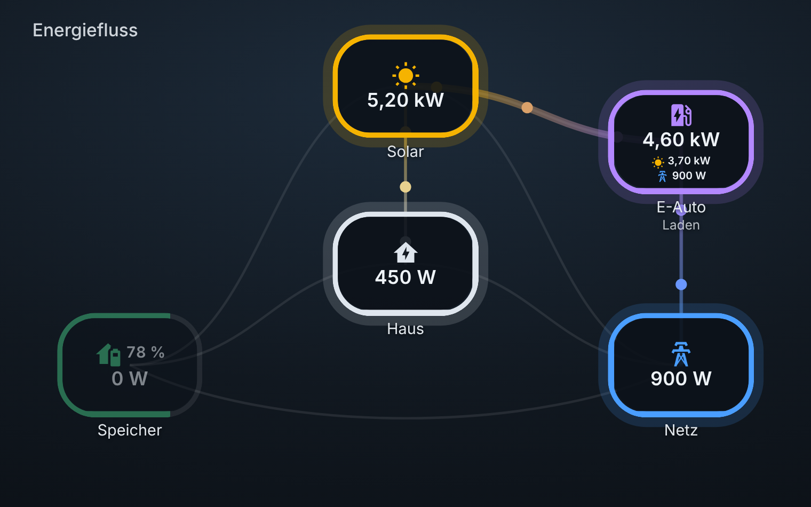

# Energy Flow Live Card

🇩🇪 Deutsch · [🇬🇧 English](README.md)

Animierte Energiefluss-Karte für [Home Assistant](https://www.home-assistant.io/): Solar, Haus, Speicher, Netz und Wallbox als frei platzierbare Knoten, verbunden durch Linien mit Farbverlauf und wandernden Punkten. Je mehr Leistung fließt, desto schneller und dicker wird die Linie.


## Funktionen

- **Frei platzierbare Knoten** per Maus oder Finger (Layout-Modus), Größe global und pro Knoten einstellbar. Schrift und Symbole wachsen mit.
- **Zwei Knotenformen:** Kreis oder Rechteck mit runden Ecken, global oder pro Knoten.
- **Linien mit Farbverlauf** von der Farbe des Startknotens zur Farbe des Zielknotens. Die ersten und letzten Prozent der Linie bleiben einfarbig (einstellbar).
- **Direkte Flüsse aus deinen Sensoren**, z. B. „Solar zum Speicher“. Die Karte rechnet nichts aus Schwellwerten zusammen.
- **Ladestand im Knoten** (Zahl plus Ring bzw. Rahmen). Der Richtungstext („lädt“, „Bezug“ …) lässt sich ein- und ausschalten.
- **Quellen-Aufteilung:** Ein Knoten kann zeigen, woher seine Leistung kommt, z. B. Solar- und Netzanteil an der Wallbox (`show_sources`).
- **Eigenes Hintergrundbild**, optional mit automatischem Wechsel nach Tageszeit und Wetter (klar, bewölkt, Regen, starker Regen – jeweils Tag und Nacht) und weichem Überblenden.
- **Visueller Editor** im Karten-Dialog. YAML ist nicht nötig.
- Beliebig viele eigene Knoten (Wärmepumpe, Pool, zweite Wallbox …).

|  |  |
| --- | --- |
| 

 |  |

## Installation

### Über HACS (empfohlen)

1. In Home Assistant **HACS** öffnen.
2. Oben rechts das Menü (drei Punkte) → **Benutzerdefinierte Repositories**.
3. Die Adresse dieses Repositorys eintragen, als Kategorie **Dashboard** wählen und hinzufügen.
4. Die Karte „Energy Flow Live Card“ in HACS suchen, herunterladen und die Seite neu laden.

HACS trägt die Ressource bei Dashboards im Bearbeitungsmodus (Storage-Modus) selbst ein.

### Manuell

1. `energy-flow-live-card.js` aus dem [neuesten Release](../../releases/latest) herunterladen und nach `/config/www/` kopieren.
2. **Einstellungen → Dashboards → Drei-Punkte-Menü → Ressourcen → Ressource hinzufügen** (der „Erweiterte Modus“ im Benutzerprofil muss aktiv sein).
3. URL `/local/energy-flow-live-card.js`, Typ **JavaScript-Modul**.
4. Seite hart neu laden (Strg + Shift + R).

Nach einem Update hilft es, an die URL eine Versionsnummer zu hängen (`/local/energy-flow-live-card.js?v=2`), damit der Browser die neue Datei lädt.

### Voraussetzungen

Ein aktueller Browser bzw. die aktuelle Home-Assistant-Companion-App (die Karte nutzt Container-Query-Einheiten und `color-mix`, also etwa Browser ab 2023).

## Schnellstart

Karte hinzufügen → **Energy Flow Live Card** wählen → im visuellen Editor Knoten und Flüsse einrichten. Oder per YAML:

```yaml
type: custom:energy-flow-live-card
title: Energiefluss
nodes:
  solar:
    entity: sensor.solar_power
  home:
    entity: sensor.house_power
  battery:
    plus:
      - sensor.battery_charge_power
    minus:
      - sensor.battery_discharge_power
    pct: sensor.battery_soc
  grid:
    plus:
      - sensor.grid_import_power
    minus:
      - sensor.grid_export_power
flows:
  - { from: solar,   to: home,    entity: sensor.solar_to_home }
  - { from: solar,   to: battery, entity: sensor.solar_to_battery }
  - { from: solar,   to: grid,    entity: sensor.solar_to_grid }
  - { from: battery, to: home,    entity: sensor.battery_to_home }
  - { from: grid,    to: home,    entity: sensor.grid_to_home }
```

Die Knoten `solar`, `home`, `battery`, `grid` und `ev` bringen Symbol, Name, Farbe und Position schon mit. Alles lässt sich überschreiben. Jeder andere Name legt einen eigenen Knoten an.

> Karte und visueller Editor gibt es auf **Deutsch und Englisch**. Die Sprache folgt automatisch der Home-Assistant-Sprache (andere Sprachen nutzen Englisch). Eigene Namen und Texte in der Config haben immer Vorrang. Die Übersetzungen stehen im Block `I18N` am Anfang der JS-Datei, weitere Sprachen sind per Pull Request willkommen.

### Wie Werte und Flüsse funktionieren

- **Knotenwert:** entweder ein einzelner Sensor (`entity`) oder die Summe der `plus`-Sensoren minus die Summe der `minus`-Sensoren. Angezeigt wird der Betrag, Sensoren in kW werden automatisch in W umgerechnet.
- **Fluss:** Der Sensor liefert die Leistung **in Flussrichtung** (von → nach). Ist er größer als `min_power`, leuchtet die Linie und die Punkte wandern. Liefert dein Sensor für diese Richtung negative Werte, setze `invert: true`.
- Leistungswerte sind in Watt (oder kW) zu liefern. Andere Einheiten werden nicht umgerechnet.

## Konfiguration

### Karte

| Option | Standard | Beschreibung |
| --- | --- | --- |
| `title` | – | Titel oben links |
| `aspect_ratio` | `1.6` | Seitenverhältnis: Zahl, `16/9` oder `image` (übernimmt das Format des Hintergrundbildes) |
| `min_power` | `20` | Ab dieser Leistung (W) gelten Knoten und Flüsse als aktiv |
| `node_size` | `18` | Knotenbreite in % der Kartenbreite. Schrift und Symbole skalieren mit |
| `node_shape` | `circle` | `circle` (Kreis) oder `rounded` (Rechteck mit runden Ecken) |
| `node_opacity` | `0.9` | Deckkraft der Knoten (0,3 bis 1) |
| `show_state_text` | `false` | Richtungstext unter dem Namen („lädt“, „entlädt“, „Bezug“, „Einspeisung“) |
| `show_sources` | `false` | Quellen-Aufteilung unter jedem Knoten mit eingehenden Flüssen (siehe unten). Auch pro Knoten einstellbar |
| `sources_mode` | `always` | `always` zeigt alle Quellen, `active` nur, wenn mindestens zwei Quellen Leistung liefern (siehe unten). Auch pro Knoten einstellbar |
| `animation` | `true` | Wandernde Punkte an/aus. Bei „Bewegung reduzieren“ im Betriebssystem bleiben sie aus |
| `line_gradient` | `true` | Farbverlauf auf den Linien. `false` = einfarbig in der Farbe des Startknotens |
| `gradient_hold` | `15` | Einfarbiger Anteil an jedem Ende der Linie in % (0 bis 45) |
| `edit_layout` | `false` | Layout-Modus zum Verschieben der Knoten (siehe unten) |

### Knoten (`nodes:`)

| Option | Beschreibung |
| --- | --- |
| `name`, `icon`, `color` | Anzeigename, MDI-Symbol (`mdi:…`), Farbe (beliebige CSS-Farbe) |
| `left`, `top` | Position des Mittelpunkts in % von Breite und Höhe |
| `size` | Eigene Größe in %. Überschreibt `node_size` |
| `shape` | `circle` oder `rounded`. Überschreibt `node_shape` |
| `entity` | Sensor mit dem Wert des Knotens |
| `plus`, `minus` | Listen von Sensoren. Wert = Summe(plus) − Summe(minus) |
| `pct` | Ladestand-Sensor (%). Zeigt Zahl im Knoten plus Ring (Kreis) bzw. Rahmen (Rechteck) |
| `status_entity` | Sensor, dessen Zustand als Text unter dem Namen steht (z. B. Wallbox-Status) |
| `label_positive`, `label_negative` | Richtungstexte bei positivem/negativem Wert (nur sichtbar bei `show_state_text`) |
| `label_idle` | Text im Ruhezustand |
| `show_state_text` | `true`/`false` überschreibt die globale Einstellung für diesen Knoten |
| `show_sources` | `true`/`false` überschreibt die globale Einstellung für diesen Knoten |
| `sources_mode` | `always` oder `active`. Überschreibt die globale Einstellung für diesen Knoten |

### Flüsse (`flows:`)

| Option | Beschreibung |
| --- | --- |
| `from`, `to` | Namen zweier Knoten |
| `entity` | Sensor mit der Leistung in Flussrichtung. Flüsse ohne Sensor werden ignoriert |
| `invert` | Vorzeichen umkehren |

## Quellen-Aufteilung

Mit `show_sources` zeigt ein Knoten in seinem Inneren kleine Zeilen, wie viel Leistung jede Quelle liefert: das Symbol der Quelle in ihrer Farbe plus den Wert. Die Zeilen entstehen aus den Flüssen, die in diesem Knoten enden. Jede Quelle braucht also einen Fluss (`from` → `to`) mit Sensor. Quellen, die gerade nichts liefern, werden abgedunkelt.

```yaml
nodes:
  ev:
    entity: sensor.wallbox_leistung
    show_sources: true     # zeigt z. B. ☀ 3,70 kW   ⚡ 900 W
flows:
  - { from: solar, to: ev, entity: sensor.solar_zu_wallbox }
  - { from: grid,  to: ev, entity: sensor.netz_zu_wallbox }
```

**Wann wird es angezeigt (`sources_mode`)?** Mit `always` (Standard) stehen alle Quellen da, ruhende sind abgedunkelt. Mit `active` erscheint die Aufteilung nur, wenn mindestens zwei Quellen gerade mehr als `min_power` liefern, und dann nur diese. Bei einer einzelnen Quelle würde sie nur die Gesamtleistung des Knotens wiederholen und bleibt deshalb ausgeblendet.

```yaml
nodes:
  ev:
    show_sources: true
    sources_mode: active
```

Beim Darüberfahren erscheint der Name der Quelle. Zwei Quellen passen gut in einen Knoten in Standardgröße. Bei drei oder mehr Quellen (oder kleinen Karten) vergrößere die `size` des Knotens und schalte die Funktion lieber pro Knoten als global ein.

## Knoten verschieben (Layout-Modus)

1. Im visuellen Editor unter „Layout“ den Layout-Modus einschalten (oder `edit_layout: true` setzen) und speichern.
2. Die Karte in der **normalen Dashboard-Ansicht** öffnen und die Knoten mit Maus oder Finger verschieben. Die Linien laufen mit, die Koordinaten werden angezeigt.
3. Im visuellen Editor übernimmt sich die Position automatisch. In YAML kopierst du die angezeigten Werte nach `left`/`top`.
4. Layout-Modus wieder ausschalten.

## Hintergrundbild und Wetter

Lege deine Bilder unter `/config/www/` ab (Erreichbar als `/local/dateiname.jpg`).

```yaml
background: /local/tag.jpg                  # Tag, klar
background_night: /local/nacht.jpg          # Nacht, klar
background_cloudy: /local/tag-wolken.jpg
background_rain: /local/tag-regen.jpg
background_heavy_rain: /local/tag-starkregen.jpg
background_night_cloudy: /local/nacht-wolken.jpg
background_night_rain: /local/nacht-regen.jpg
background_night_heavy_rain: /local/nacht-starkregen.jpg
weather_entity: weather.home
aspect_ratio: image
background_dim: 0.6        # 0 = keine Abdunkelung, 1 = schwarz
background_fit: cover      # cover | contain | 100% 100%
```

- **Tag/Nacht** kommt von `sun.sun` (anderer Name über `sun_entity`).
- **Wetter** kommt aus der `weather.*`-Entität:

  | Bild | Wetterzustände |
  | --- | --- |
  | Regen | `rainy`, `snowy-rainy` |
  | Starker Regen | `pouring`, `lightning-rainy` |
  | Bewölkt | `cloudy` |
  | Klar | alles andere (`sunny`, `partlycloudy`, `fog`, `snowy` …) |

- **Fehlende Bilder:** Die Karte nimmt ersatzweise „klar“ (nachts erst „Nacht, klar“, dann „Tag, klar“). Du musst also nicht alle acht Bilder anlegen.
- Alle Bilder sollten **dasselbe Seitenverhältnis** haben. Mit `aspect_ratio: image` richtet sich die Karte nach dem ersten vorhandenen Bild.
- **Testen:** Mit `background_preview` erzwingst du ein Bild, ohne auf das Wetter zu warten: `day`, `day_cloudy`, `day_rain`, `day_heavy_rain`, `night`, `night_cloudy`, `night_rain`, `night_heavy_rain`. Danach wieder entfernen (im visuellen Editor: „Automatisch“).

## Fehlerbehebung

| Problem | Lösung |
| --- | --- |
| „Custom element doesn't exist: energy-flow-live-card“ | Ressource fehlt oder falscher Typ. Sie muss als **JavaScript-Modul** eingetragen sein. Danach hart neu laden |
| Nach einem Update sieht alles aus wie vorher | Browser-Cache. Hart neu laden oder `?v=…` an die Ressourcen-URL hängen. In der Companion-App: Cache zurücksetzen |
| Knoten lassen sich nicht verschieben | Im Bearbeitungsmodus des Dashboards liegt eine Fläche über den Karten. Die normale Ansicht benutzen oder die Positionen im Editor einstellen |
| Eine Linie leuchtet nie | Prüfen, ob der Flusssensor Werte in Flussrichtung liefert (größer als `min_power`). Sonst `invert: true` |
| Ein Knoten zeigt „–“ | Der Sensor existiert nicht oder ist `unavailable`. Entity-ID prüfen |

## Mitmachen

Fehler und Wünsche gern als [Issue](../../issues) melden. Bitte die Karten-Konfiguration (ohne persönliche Daten) und die Home-Assistant-Version angeben.

## Danksagung

Die Idee stammt von [Steve-gnome/energy-flow-card](https://github.com/Steve-gnome/energy-flow-card) (MIT). Diese Karte ist eine eigene Umsetzung mit anderem Ansatz: Flüsse kommen direkt aus Sensoren, dazu kommen visueller Editor, frei wählbare Knoten und Formen, Farbverläufe und Wetter-Hintergründe.

## Lizenz

[MIT](LICENSE)
