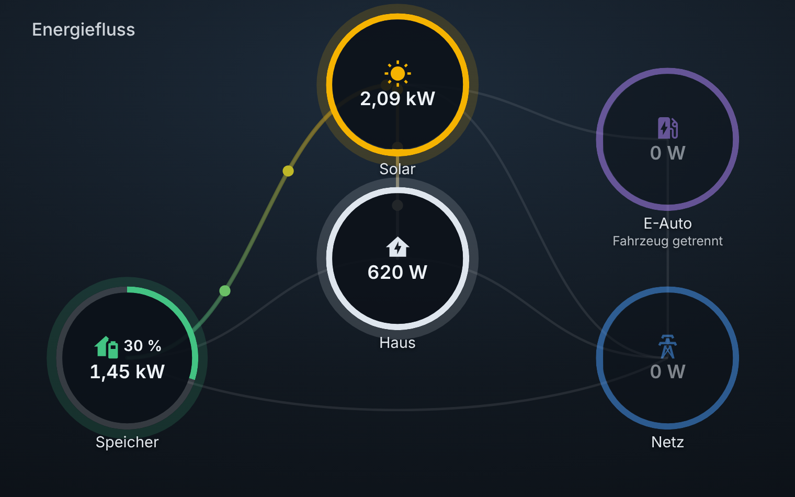
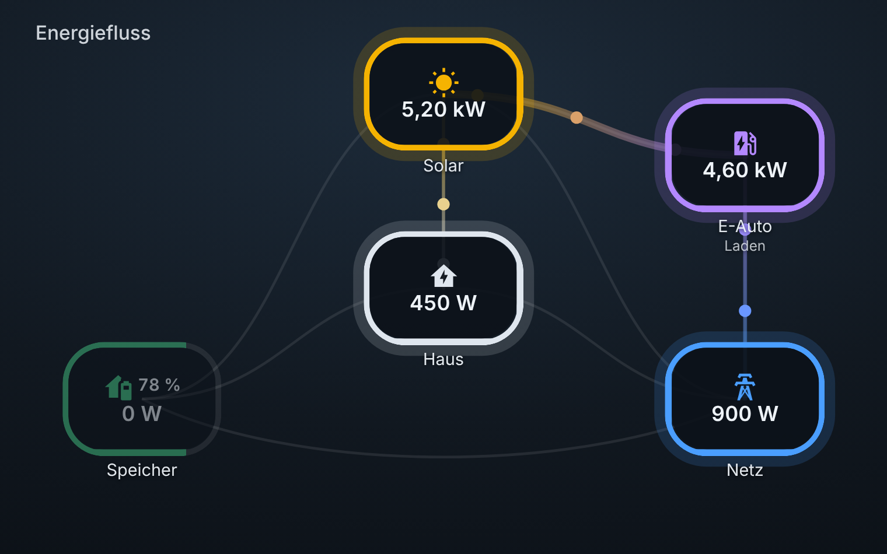
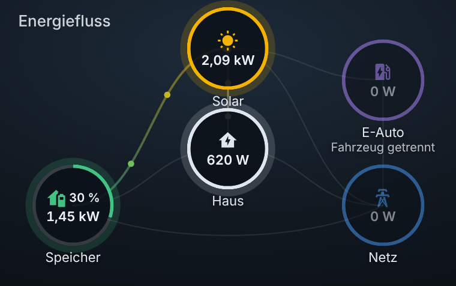

# Energy Flow Live Card

🇬🇧 English · [🇩🇪 Deutsch](README.de.md)

An animated energy-flow card for [Home Assistant](https://www.home-assistant.io/): solar, home, battery, grid and EV charger as freely positionable nodes, connected by gradient lines with moving dots. The more power flows, the faster and thicker the line.



## Features

- **Freely positionable nodes** by mouse or finger (layout mode). Size is adjustable globally and per node; text and icons scale with it.
- **Two node shapes:** circle or rounded rectangle, globally or per node.
- **Gradient lines** from the start node's color to the target node's color. The first and last part of each line stays solid (adjustable).
- **Flows come straight from your sensors**, e.g. "solar to battery". The card does not derive anything from thresholds.
- **State of charge inside the node** (number plus ring/frame). The direction text ("charging", "import" …) can be switched on or off.
- **Your own background image**, optionally switching automatically by time of day and weather (clear, cloudy, rain, heavy rain – each day and night) with a smooth cross-fade.
- **Visual editor** in the card dialog. No YAML required.
- Any number of custom nodes (heat pump, pool, second charger …).

|  |  |
| --- | --- |
|  |  |

## Installation

### HACS (recommended)

1. Open **HACS** in Home Assistant.
2. Top right menu (three dots) → **Custom repositories**.
3. Enter this repository's URL, choose category **Dashboard**, and add it.
4. Find "Energy Flow Live Card" in HACS, download it, and reload the page.

### Manual

1. Download `energy-flow-live-card.js` from the [latest release](../../releases/latest) and copy it to `/config/www/`.
2. **Settings → Dashboards → three-dot menu → Resources → Add resource** (Advanced mode must be enabled in your user profile).
3. URL `/local/energy-flow-live-card.js`, type **JavaScript module**.
4. Hard-reload the page (Ctrl + Shift + R).

After an update, appending a version to the URL (`/local/energy-flow-live-card.js?v=2`) forces the browser to load the new file.

### Requirements

A current browser or the current Home Assistant companion app (the card uses container query units and `color-mix`, i.e. browsers from about 2023).

## Quick start

Add card → choose **Energy Flow Live Card** → set up nodes and flows in the visual editor. Or in YAML:

```yaml
type: custom:energy-flow-live-card
title: Energy flow
nodes:
  solar:
    entity: sensor.solar_power
  home:
    entity: sensor.house_power
  battery:
    plus:
      - sensor.battery_charge_power
    minus:
      - sensor.battery_discharge_power
    pct: sensor.battery_soc
  grid:
    plus:
      - sensor.grid_import_power
    minus:
      - sensor.grid_export_power
flows:
  - { from: solar,   to: home,    entity: sensor.solar_to_home }
  - { from: solar,   to: battery, entity: sensor.solar_to_battery }
  - { from: solar,   to: grid,    entity: sensor.solar_to_grid }
  - { from: battery, to: home,    entity: sensor.battery_to_home }
  - { from: grid,    to: home,    entity: sensor.grid_to_home }
```

The nodes `solar`, `home`, `battery`, `grid` and `ev` come with icon, name, color and position built in. Everything can be overridden. Any other name creates a custom node.

### How values and flows work

- **Node value:** either a single sensor (`entity`) or the sum of the `plus` sensors minus the sum of the `minus` sensors. The absolute value is shown; sensors in kW are converted to W automatically.
- **Flow:** the sensor reports the power **in flow direction** (from → to). Above `min_power` the line lights up and the dots move. If your sensor reports negative values for that direction, set `invert: true`.
- Provide power in watts (or kW). Other units are not converted.

## Language

The card and its visual editor are available in **English and German** and follow the Home Assistant language automatically (any other language falls back to English). This covers default node names ("Home", "Battery", "Grid" …), the direction texts ("charging", "import" …), all editor labels and the screen reader text.

Your own texts always win. To use other names or another language, override them in the config:

```yaml
nodes:
  battery: { name: Batterie, label_positive: charging, label_negative: discharging }
```

Numbers are formatted according to the Home Assistant language. Translations live in the `I18N` block at the top of `energy-flow-live-card.js`. Pull requests with additional languages are welcome.

## Configuration

### Card

| Option | Default | Description |
| --- | --- | --- |
| `title` | – | Title at the top left |
| `aspect_ratio` | `1.6` | Aspect ratio: number, `16/9`, or `image` (uses the background image's ratio) |
| `min_power` | `20` | Power (W) above which nodes and flows count as active |
| `node_size` | `18` | Node width in % of card width. Text and icons scale with it |
| `node_shape` | `circle` | `circle` or `rounded` (rounded rectangle) |
| `node_opacity` | `0.9` | Node opacity (0.3 to 1) |
| `show_state_text` | `false` | Direction text under the name ("charging", "import" …) |
| `animation` | `true` | Moving dots on/off. Stays off if the OS requests reduced motion |
| `line_gradient` | `true` | Gradient on the lines. `false` = solid color of the start node |
| `gradient_hold` | `15` | Solid share at each end of a line in % (0 to 45) |
| `edit_layout` | `false` | Layout mode for moving nodes (see below) |

### Nodes (`nodes:`)

| Option | Description |
| --- | --- |
| `name`, `icon`, `color` | Display name, MDI icon (`mdi:…`), color (any CSS color) |
| `left`, `top` | Center position in % of width and height |
| `size` | Own size in %. Overrides `node_size` |
| `shape` | `circle` or `rounded`. Overrides `node_shape` |
| `entity` | Sensor with the node's value |
| `plus`, `minus` | Lists of sensors. Value = sum(plus) − sum(minus) |
| `pct` | State-of-charge sensor (%). Shows the number in the node plus ring (circle) or frame (rounded) |
| `status_entity` | Sensor whose state is shown under the name (e.g. charger status) |
| `label_positive`, `label_negative` | Direction texts for positive/negative value (only visible with `show_state_text`) |
| `label_idle` | Text when idle |
| `show_state_text` | `true`/`false` overrides the global setting for this node |

### Flows (`flows:`)

| Option | Description |
| --- | --- |
| `from`, `to` | Names of two nodes |
| `entity` | Sensor with the power in flow direction. Flows without a sensor are ignored |
| `invert` | Flip the sign |

## Moving nodes (layout mode)

1. In the visual editor under "Layout" switch layout mode on (or set `edit_layout: true`) and save.
2. Open the card in the **normal dashboard view** and drag the nodes with mouse or finger. The lines follow and the coordinates are shown.
3. In the visual editor positions are picked up automatically. In YAML copy the shown values to `left`/`top`.
4. Switch layout mode off again.

## Background image and weather

Put your images in `/config/www/` (available as `/local/filename.jpg`).

```yaml
background: /local/day.jpg                    # day, clear
background_night: /local/night.jpg            # night, clear
background_cloudy: /local/day-cloudy.jpg
background_rain: /local/day-rain.jpg
background_heavy_rain: /local/day-heavy-rain.jpg
background_night_cloudy: /local/night-cloudy.jpg
background_night_rain: /local/night-rain.jpg
background_night_heavy_rain: /local/night-heavy-rain.jpg
weather_entity: weather.home
aspect_ratio: image
background_dim: 0.6        # 0 = no dimming, 1 = black
background_fit: cover      # cover | contain | 100% 100%
```

- **Day/night** comes from `sun.sun` (other entity via `sun_entity`).
- **Weather** comes from the `weather.*` entity:

  | Image | Weather states |
  | --- | --- |
  | Rain | `rainy`, `snowy-rainy` |
  | Heavy rain | `pouring`, `lightning-rainy` |
  | Cloudy | `cloudy` |
  | Clear | everything else (`sunny`, `partlycloudy`, `fog`, `snowy` …) |

- **Missing images:** the card falls back to "clear" (at night first "night, clear", then "day, clear"). You don't need all eight images.
- All images should share the **same aspect ratio**. With `aspect_ratio: image` the card follows the first available image.
- **Testing:** `background_preview` forces an image without waiting for the weather: `day`, `day_cloudy`, `day_rain`, `day_heavy_rain`, `night`, `night_cloudy`, `night_rain`, `night_heavy_rain`. Remove it afterwards (visual editor: "Automatic").

## Troubleshooting

| Problem | Solution |
| --- | --- |
| "Custom element doesn't exist: energy-flow-live-card" | Resource missing or wrong type. It must be registered as a **JavaScript module**. Then hard-reload |
| Nothing changes after an update | Browser cache. Hard-reload or append `?v=…` to the resource URL. In the companion app: clear the cache |
| Nodes can't be moved | In dashboard edit mode an overlay covers the cards. Use the normal view or set positions in the editor |
| A line never lights up | Check that the flow sensor reports values in flow direction (above `min_power`). Otherwise use `invert: true` |
| A node shows "–" | The sensor doesn't exist or is `unavailable`. Check the entity ID |

## Contributing

Please report bugs and requests as an [issue](../../issues), including your card config (without personal data) and your Home Assistant version.

## Credits

Inspired by [Steve-gnome/energy-flow-card](https://github.com/Steve-gnome/energy-flow-card) (MIT). This card is an independent implementation with a different approach: flows come directly from sensors, plus a visual editor, freely positionable nodes and shapes, color gradients and weather backgrounds.

## License

[MIT](LICENSE)
